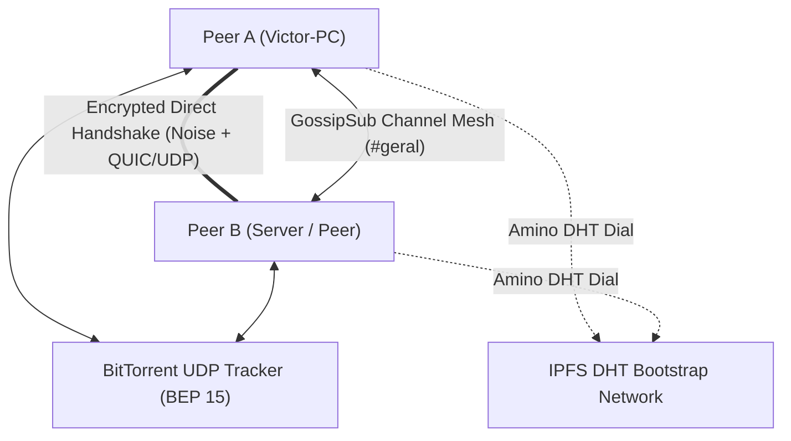

<div align="center">

# ⚡ Anarchord

### The Serverless, Zero-Censorship, 100% Peer-to-Peer Discord Engine

[](https://www.rust-lang.org/)
[](LICENSE)
[](https://libp2p.io/)
[](https://noiseprotocol.org/)
[]()

**Anarchord** is an open-source, serverless communication ecosystem inspired by Discord.  
Built in **Rust** from the ground up, it eliminates centralized servers, tracking, and corporate gatekeeping by establishing a decentralized, encrypted mesh between peer nodes using **IPFS Amino DHT**, **BitTorrent Open Trackers**, and **libp2p**.

</div>

---

## 🌟 Key Features

* 🔐 **Cryptographic Self-Sovereign Identity:** No emails, passwords, or phone numbers. Your identity is a permanent **Ed25519** keypair stored locally.
* 🌐 **Hybrid Auto-Discovery (Zero-Config):**
  * **Primary:** Global IPFS Amino DHT bootstrap nodes.
  * **Fallback:** Public BitTorrent UDP Trackers (BEP 15) querying deterministic hashes in < 500ms.
* 💬 **Mesh Text Channels & Terminal UI (TUI):** Built on `libp2p-gossipsub` with end-to-end cryptographic message signing (`Ed25519`), **MLS** (RFC 9420) encrypted servers, and a reactive, interactive dashboard built with **Ratatui** (featuring dynamic online peers, friends list with presence, audio meters, blinking input cursor, and mouse support).
* 🔒 **1:1 E2EE Direct Messages & Offline Friend Guardians:** Private direct messages encrypted with **X25519** + **HKDF-SHA256** + **ChaCha20-Poly1305** and **Ephemeral Session Keys** (Forward Secrecy). Offline messages are delivered via **Friend Guardians** using a **Sign-then-Seal** store-and-forward mailbox with event-driven delegation, sovereign TTL negotiation, and restart-safe deduplication (`ReceiptAck`).
* 🛡️ **Asymmetric DM Application Firewall:** Configurable per-node defense (`config.json` / `/firewall`) distinguishing **Friends** from **Strangers** (since friendship is asymmetric), with progressive rate/size/offline blocking (`1m → 5m → 30m → 24h`) and a single E2EE courtesy block notice.
* 📁 **Decentralized File Swarm (IPFS CIDv1):** Multi-peer chunked file delivery (`/anarchord/files/1`) with SHA-256 verification, seeder promotion, automatic resume across restarts, and per-chunk encryption inside servers.
* 🎙️ **Real-Time Voice Architecture (Opus 48kHz):** Full-duplex microphone capture, low-latency Opus audio compression, Jitter Buffering, VAD (Voice Activity Detection), and multi-peer audio mixing.
* 📺 **P2P Screen Sharing & Real-Time H.264 Video Stream:** Screen and display capture engine via `xcap` with hardware/native **H.264** compression (`openh264` at 30 FPS with periodic SPS/PPS IDR keyframes, <2ms downscaling, and JPEG fallback), live viewer window via `minifb` displaying real-time FPS, bitrate, and transfer metrics.
* 🐳 **Multi-Stage Docker, 15 Isolated Lab Scenarios & Raw Packet Sniffer:** Distributed test lab (`lab/run.py`): every peer is a container behind its own real NAT router (iptables, cone or symmetric), driven over stdin/stdout by a Python orchestrator with a built-in **Raw Application Packet Sniffer** (`sniffer.rs` / `packets.jsonl`) that dissects wire frames, keys, nonces, ciphertexts, and cryptographic signatures.
* 🚪 **Dynamic OS Ephemeral Ports:** No need to configure or hardcode ports; the OS assigns available ports on boot and announces them automatically.
* 🤝 **Intelligent Connection Deduplication:** Detects simultaneous handshakes and tears down redundant connections without dropping the primary session.
* 🛡️ **NAT Traversal & Firewall Punching:** Built-in **DCUtR** (Direct Connection Upgrade through Relay) and **AutoNAT** protocols.

---

## 🏗️ Architecture Overview

The repository is organized as a modular Cargo Workspace:

```text
anarchord/
├── crates/
│   ├── p2p-core/      # Core headless P2P engine (Identity, DHT, Trackers, GossipSub, MLS, DMs, Mailbox, Sniffer)
│   ├── p2p-cli/       # Interactive Ratatui terminal client and screen viewer
│   └── p2p-agent/     # Headless JSON-over-stdio node for bots and distributed lab testing
├── lab/               # Distributed Docker + real NAT test lab (anarlab) & 15 automated scenarios
├── Cargo.toml         # Workspace definition
└── README.md
```

### Communication & Discovery Flow



---

## 🚀 Quick Start (Running the CLI)

### Prerequisites
* [Rust](https://rustup.rs/) (stable toolchain)
* Git

### 1. Clone the repository
```bash
git clone https://github.com/VictorGerin/anarchord.git
cd anarchord
```

### 2. Run your P2P Node
Simply launch the client. Anarchord will generate your cryptographic key on first boot and automatically join the network:

```bash
cargo run -p p2p-cli -- --nick "YourNickname"
```

> **Note:** Anarchord automatically picks a free dynamic port from your OS and discovers active peers across the globe via BitTorrent open trackers and the IPFS DHT!

---

## 💬 Interactive CLI Commands

While inside the chat console, you can use built-in slash commands:

| Command | Action |
| :--- | :--- |
| `<message>` + `Enter` | Sends a cryptographically signed message to the active channel or active `@Friend` DM space. |
| `/peers` | Displays all currently connected P2P peers, their public Peer IDs, announced/negotiated protocol versions (`v1-v2`), and active capabilities. |
| `/join <channel>` / `/lobby` | Dynamically switches chat rooms (e.g., `/join gaming`) or returns to the Lobby. |
| `/friends` | Lists all friends in `identity.json` with their online/offline presence status. |
| `/friend add <pubkey\|nick> [alias]` | Adds a peer to your local friends list (authorizing them as a mutual DM guardian). |
| `/friend remove <pubkey\|nick>` | Removes a peer from your friends list. |
| `/dm <peer> <msg> [--ttl <duration>]` | Sends a 1:1 E2EE Direct Message (with optional offline guardian TTL override). |
| `/dm open <peer>` | Opens a dedicated `@Peer` E2EE Direct Message conversation space in the TUI. |
| `/config` / `/config set <key> <val>` | Views or updates node configuration (`config.json`: mailbox quotas, TTLs, DM firewall limits). |
| `/firewall` / `/firewall unblock <peer>` | Inspects active DM firewall policies/blocks or manually unblocks a peer. |
| `/server ...` | Creates and manages decentralized MLS-encrypted servers, invites, channels, roles, and bans. |
| `/share <file>` / `/send <peer> <file>` | Shares a file in the current space swarm (`CIDv1`) or sends directly to a peer. |
| `/get <id>` / `/reject <id>` / `/files` | Downloads an offered file, rejects an offer, or lists active/completed transfers. |
| `/voice join <room>` / `/voice leave` | Joins or leaves real-time P2P voice mesh with Opus audio. |
| `/mute` | Toggles microphone mute/unmute state. |
| `/devices` | Lists available audio input (mics) and output (speakers) hardware devices. |
| `/screen list` | Lists all detected physical monitors and displays. |
| `/screen start [monitor_idx]` | Starts real-time screen capture and streaming to the P2P mesh. |
| `/screen stop` | Stops active screen share broadcast. |
| `/screen watch <peer>` | Opens a native lightweight window (`minifb`) to watch a peer's screen in real time. |
| `/quit` | Cleanly shuts down the node and closes network sockets. |

---

## 🗺️ Project Roadmap

### Phase 1: Core Network & Discovery ✅ (Completed)
- [x] Cryptographic Identity generation & persistence (`Ed25519Dalek`).
- [x] Transport layers: **QUIC** (UDP) and **TCP** with **Yamux** and **Noise Protocol**.
- [x] Dual-engine Auto-Discovery:
  - [x] IPFS Amino DHT Bootstrap.
  - [x] BitTorrent UDP Open Trackers Client (BEP 15) with compact peer parsing.
- [x] Connection deduplication via `close_connection`.
- [x] OS dynamic port allocation (`port = 0`).
- [x] Periodic 10s Tracker re-announcement and continuous peer re-discovery.
- [x] Distributed Docker test lab with real NAT routers (`lab/run.py`).

### Phase 2: Decentralized Text Mesh, TUI & File Swarm ✅ (Completed)
- [x] GossipSub channel routing (e.g. `p2p-anarchord/channel/<channel>`).
- [x] Cryptographic verification: All messages signed by author's private key.
- [x] Interactive Terminal User Interface (**Ratatui**) with dynamic online peers, blinking input cursor, and mouse click interactions.
- [x] Direct P2P File Swarm subsystem (`CIDv1`, `/anarchord/files/1`, seeder promotion, resume, server encryption).
- [x] Offline 1:1 DM delivery via Friend Guardians ([#37](https://github.com/VictorGerin/anarchord/issues/37)); channel/server history synchronization tracked in v0.4 ([#26](https://github.com/VictorGerin/anarchord/issues/26), [#39](https://github.com/VictorGerin/anarchord/issues/39)).

### Phase 3: Real-Time P2P Voice (Opus) ✅ (Completed)
- [x] `VoicePacket` 20ms protocol specification with VAD energy calculation.
- [x] `JitterBuffer` with sequence sorting and duplicate/late packet dropping.
- [x] Native audio capture & playback via `cpal` (WASAPI, ALSA).
- [x] Opus audio compression & decompression (`opus1` VoIP mode @ 48kHz).
- [x] Multi-peer audio mixing and active speaker indicators (`[FALANDO]`).
- [x] Headless synthetic audio generator (`anarchord-agent --synth-audio`) for automated testing.

### Phase 4: Screen Sharing & Native Video Streaming ✅ (Completed)
- [x] Cross-platform screen and window capture engine via `xcap`.
- [x] Real-time H.264 video codec integration (`openh264` 30 FPS) with periodic SPS/PPS intra-frames and high-speed downscaling.
- [x] Pure Rust JPEG fallback encoder (`jpeg-encoder`).
- [x] Real-time P2P video frame distribution (`ScreenPacket`) across Gossipsub mesh.
- [x] Ultra-lightweight native graphical viewer window via `minifb` (`/screen watch <peer>`) with real-time FPS, bitrate, and data metrics.
- [x] Automated loop video transmission (`anarchord-agent --synth-video`) for server/bot testing.
- [x] Scenario-based multi-peer lab (`lab/scenarios.py`) driving 2+ nodes behind separate NATs.

### Phase 5: Servers, Moderation & End-to-End Encryption ✅ (Completed)
- [x] Servers with a signed configuration chain (channels, rules, bans, allow-list) and moderator certificates.
- [x] Server content (chat, voice, screen, file offers) end-to-end encrypted with **MLS** (RFC 9420, `openmls`).

### Phase 6: Friends, 1:1 E2EE Direct Messages, Offline Guardian Mailbox & DM Firewall ✅ (Completed)
- [x] Friends list in `identity.json` with real-time online/offline presence and TUI context menus ([#34](https://github.com/VictorGerin/anarchord/issues/34), [#35](https://github.com/VictorGerin/anarchord/issues/35)).
- [x] 1:1 E2EE Direct Messages (`X25519` + `HKDF-SHA256` + `ChaCha20-Poly1305`) with Ephemeral Session Keys (Forward Secrecy) and dedicated `@Friend` TUI spaces ([#36](https://github.com/VictorGerin/anarchord/issues/36)).
- [x] Decentralized Offline Store-and-Forward Mailbox via Friend Guardians (`Sign-then-Seal` envelopes, 100% event-driven guardian delegation, sovereign TTL negotiation, and persistent `ReceiptAck` deduplication across restarts) ([#37](https://github.com/VictorGerin/anarchord/issues/37)).
- [x] OS-agnostic configuration system (`config.json` / `/config`) for mailbox quotas, TTLs, and DM policies ([#38](https://github.com/VictorGerin/anarchord/issues/38)).
- [x] Asymmetric DM Application Firewall (Friends vs. Strangers limits, progressive blocking `1m → 5m → 30m → 24h`, single E2EE courtesy block notice, `/firewall`) ([#48](https://github.com/VictorGerin/anarchord/issues/48)).
- [x] Raw Application Packet Sniffer (`sniffer.rs`) & cryptographic wire dissector in `anarlab` (`packets.jsonl` / `packets.log`).

### Phase 7: Swarm Optimization, Dynamic Resume & Protocol Engine ✅ (Completed)
- [x] Protocol versioning & cross-version compatibility engine (`v1..=v2`) with Identify negotiation ([#51](https://github.com/VictorGerin/anarchord/issues/51), [#61](https://github.com/VictorGerin/anarchord/issues/61)).
- [x] Swarm traffic isolation via dedicated per-file Gossipsub topics (`anarchord/file/<cid>`) ([#66](https://github.com/VictorGerin/anarchord/issues/66)).
- [x] Download resume and automatic provider reconnection across application restarts ([#68](https://github.com/VictorGerin/anarchord/issues/68)).
- [x] Re-download support for deleted files using OS-level filesystem events (`notify`) ([#64](https://github.com/VictorGerin/anarchord/issues/64)).
- [x] Terminal QoL: auto-complete for file CIDs in `/get`, interactive popup in `/files` ([#63](https://github.com/VictorGerin/anarchord/issues/63)), and chronological timestamp sorting ([#62](https://github.com/VictorGerin/anarchord/issues/62)).

### Upcoming milestones
Tracked as [GitHub milestones](https://github.com/VictorGerin/anarchord/milestones); every item is an issue with acceptance criteria. Design principles and threat model: [wiki](https://github.com/VictorGerin/anarchord/wiki/Principios-e-Modelo-de-Ameacas).

**v0.2 Core, Friends & File Swarm** ⏳
- [x] Protocol versioning & cross-version compatibility engine [#51](https://github.com/VictorGerin/anarchord/issues/51), [#61](https://github.com/VictorGerin/anarchord/issues/61)
- [x] Swarm traffic isolation & download resume across restarts [#66](https://github.com/VictorGerin/anarchord/issues/66), [#68](https://github.com/VictorGerin/anarchord/issues/68)
- [ ] Separation of Identity (Signing) and Encryption (X25519) keys with rotation [#69](https://github.com/VictorGerin/anarchord/issues/69)
- [ ] Mutual friend request protocol with offline guardian support [#70](https://github.com/VictorGerin/anarchord/issues/70)
- [ ] Mailbox optimization (Base64 for binary arrays) and reliable message pruning [#71](https://github.com/VictorGerin/anarchord/issues/71)
- [ ] Handle unshared or unavailable downloads gracefully (prevent 0% stalls) [#67](https://github.com/VictorGerin/anarchord/issues/67)
- [ ] Bandwidth and rate limiting configuration for file transfers [#65](https://github.com/VictorGerin/anarchord/issues/65)
- [ ] Encrypted space indicator 🔐 in TUI [#16](https://github.com/VictorGerin/anarchord/issues/16)
- [ ] Clean up terminal logging and hole punching noise in System tab [#40](https://github.com/VictorGerin/anarchord/issues/40), [#28](https://github.com/VictorGerin/anarchord/issues/28)

**v0.3 Servers & Moderation**
- [ ] Certified moderators can admit/remove MLS members without owner online [#42](https://github.com/VictorGerin/anarchord/issues/42)
- [ ] Signed invites (expiry, recipient, message) [#43](https://github.com/VictorGerin/anarchord/issues/43), direct invites [#44](https://github.com/VictorGerin/anarchord/issues/44), usage limits [#50](https://github.com/VictorGerin/anarchord/issues/50)
- [ ] Server crypto hardening & keys encrypted at rest [#45](https://github.com/VictorGerin/anarchord/issues/45)
- [ ] Configuration chain consolidation [#52](https://github.com/VictorGerin/anarchord/issues/52)
- [ ] MLS & control-topic scaling [#53](https://github.com/VictorGerin/anarchord/issues/53), control topic split by function [#58](https://github.com/VictorGerin/anarchord/issues/58)
- [ ] Server discovery: open directory and tag search [#60](https://github.com/VictorGerin/anarchord/issues/60)
- [ ] Metadata leakage review (topics, DHT) [#47](https://github.com/VictorGerin/anarchord/issues/47)

**v0.4 Channels, History & Room Presence**
- [x] 1:1 DMs with ephemeral session keys [#36](https://github.com/VictorGerin/anarchord/issues/36) and offline delivery via guardians [#37](https://github.com/VictorGerin/anarchord/issues/37)
- [x] Configurable node & mailbox limits (`config.json` / `/config`) [#38](https://github.com/VictorGerin/anarchord/issues/38)
- [ ] Cooperative channel/server history synchronization for offline members [#39](https://github.com/VictorGerin/anarchord/issues/39), [#26](https://github.com/VictorGerin/anarchord/issues/26)
- [ ] Per-channel encryption: ephemeral MLS groups with elected room leader [#46](https://github.com/VictorGerin/anarchord/issues/46)
- [ ] Room presence by join/leave, no polling [#55](https://github.com/VictorGerin/anarchord/issues/55)
- [ ] Topic subscriptions only for active rooms [#56](https://github.com/VictorGerin/anarchord/issues/56)

**v0.5 Distribution, Release & Clients**
- [ ] Signed and verifiable binary releases & auto-update [#49](https://github.com/VictorGerin/anarchord/issues/49)
- [ ] Git-based SemVer automation (`release.py`, `build.rs`) [#19](https://github.com/VictorGerin/anarchord/issues/19)
- [ ] Lab performance metrics [#57](https://github.com/VictorGerin/anarchord/issues/57) and automated lab in GitHub Actions CI [#18](https://github.com/VictorGerin/anarchord/issues/18)
- [ ] Media relay protocol for large voice/screen rooms [#54](https://github.com/VictorGerin/anarchord/issues/54)
- [ ] Light nodes [#59](https://github.com/VictorGerin/anarchord/issues/59) and mobile apps [#27](https://github.com/VictorGerin/anarchord/issues/27)
- [ ] Desktop GUI with **Tauri** [#25](https://github.com/VictorGerin/anarchord/issues/25)

---

## 🧪 Testing

Anarchord maintains comprehensive automated unit, integration, TUI, and distributed NAT container tests across all modules.

To run the complete test suite:
```bash
cargo test --workspace
python lab/run.py
```

---

## 📄 License

This project is licensed under the **MIT License** - see the [LICENSE](LICENSE) file for details.
