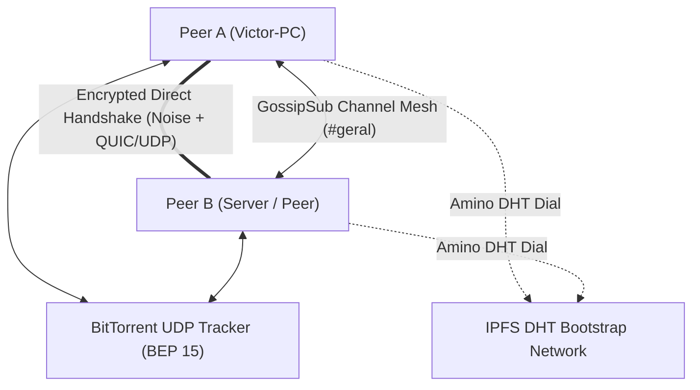

<div align="center">

# ⚡ Anarchord

### The Serverless, Zero-Censorship, 100% Peer-to-Peer Discord Engine

[](https://www.rust-lang.org/)
[](LICENSE)
[](https://libp2p.io/)
[](https://noiseprotocol.org/)
[]()

**Anarchord** is an open-source, serverless communication ecosystem inspired by Discord.  
Built in **Rust** from the ground up, it eliminates centralized servers, tracking, and corporate gatekeeping by establishing a decentralized, encrypted mesh between peer nodes using **IPFS Amino DHT**, **BitTorrent Open Trackers**, and **libp2p**.

</div>

---

## 🌟 Key Features

* 🔐 **Cryptographic Self-Sovereign Identity:** No emails, passwords, or phone numbers. Your identity is a permanent **Ed25519** keypair stored locally.
* 🌐 **Hybrid Auto-Discovery (Zero-Config):**
  * **Primary:** Global IPFS Amino DHT bootstrap nodes.
  * **Fallback:** Public BitTorrent UDP Trackers (BEP 15) querying deterministic hashes in < 500ms.
* 💬 **Mesh Text Channels:** Built on `libp2p-gossipsub` with end-to-end cryptographic message signing (`Ed25519`).
* 🚪 **Dynamic OS Ephemeral Ports:** No need to configure or hardcode ports; the OS assigns available ports on boot and announces them automatically.
* 🤝 **Intelligent Connection Deduplication:** Detects simultaneous handshakes and tears down redundant connections without dropping the primary session.
* 🎙️ **Real-Time Voice Architecture:** Packetized 20ms frames with Jitter Buffer, sequence ordering, and Voice Activity Detection (VAD).
* 🛡️ **NAT Traversal & Firewall Punching:** Built-in **DCUtR** (Direct Connection Upgrade through Relay) and **AutoNAT** protocols.

---

## 🏗️ Architecture Overview

The repository is organized as a modular Cargo Workspace:

```text
anarchord/
├── crates/
│   ├── p2p-core/      # Core headless P2P engine (Identity, DHT, Trackers, GossipSub, Audio Buffer)
│   └── p2p-cli/       # Interactive terminal client and background daemon
├── Cargo.toml         # Workspace definition
└── README.md
```

### Communication & Discovery Flow



---

## 🚀 Quick Start (Running the CLI)

### Prerequisites
* [Rust](https://rustup.rs/) (stable toolchain)
* Git

### 1. Clone the repository
```bash
git clone https://github.com/VictorGerin/anarchord.git
cd anarchord
```

### 2. Run your P2P Node
Simply launch the client. Anarchord will generate your cryptographic key on first boot and automatically join the network:

```bash
cargo run -p p2p-cli -- --nick "YourNickname"
```

> **Note:** Anarchord automatically picks a free dynamic port from your OS and discovers active peers across the globe via BitTorrent open trackers and the IPFS DHT!

---

## 💬 Interactive CLI Commands

While inside the chat console, you can use built-in slash commands:

| Command | Action |
| :--- | :--- |
| `<message>` + `Enter` | Sends a cryptographically signed message to the active channel. |
| `/peers` | Displays all currently connected P2P peers and their public Peer IDs. |
| `/join <channel>` | Dynamically switches chat rooms (e.g., `/join gaming`) without restarting. |
| `/quit` | Cleanly shuts down the node and closes network sockets. |

---

## 🗺️ Project Roadmap

### Phase 1: Core Network & Discovery ✅ (Completed)
- [x] Cryptographic Identity generation & persistence (`Ed25519Dalek`).
- [x] Transport layers: **QUIC** (UDP) and **TCP** with **Yamux** and **Noise Protocol**.
- [x] Dual-engine Auto-Discovery:
  - [x] IPFS Amino DHT Bootstrap.
  - [x] BitTorrent UDP Open Trackers Client (BEP 15) with compact peer parsing.
- [x] Connection deduplication via `close_connection`.
- [x] OS dynamic port allocation (`port = 0`).

### Phase 2: Decentralized Text Mesh ✅ (Completed)
- [x] GossipSub channel routing (e.g. `p2p-discord/channel/<channel>`).
- [x] Cryptographic verification: All messages signed by author's private key.
- [x] Live channel switching (`/join`) and peer inspection (`/peers`).
- [ ] Offline history synchronization via peer-to-peer Request-Response.

### Phase 3: Real-Time P2P Voice 🔄 (In Progress)
- [x] `VoicePacket` 20ms protocol specification with VAD energy calculation.
- [x] `JitterBuffer` with sequence sorting and duplicate/late packet dropping.
- [ ] Native audio capture & playback via `cpal`.
- [ ] Opus audio compression & decompression (`audiopus`).

### Phase 4: Modern Desktop & Mobile UI ⏳ (Upcoming)
- [ ] Cross-platform client with **Tauri** (Rust + React / Tailwind CSS).
- [ ] Server creation & cryptographically signed community metadata.
- [ ] Screen sharing and video stream distribution.

---

## 🧪 Testing

Anarchord maintains comprehensive automated unit and integration tests across all modules.

To run the complete test suite:
```bash
cargo test --workspace
```

---

## 📄 License

This project is licensed under the **MIT License** - see the [LICENSE](LICENSE) file for details.
