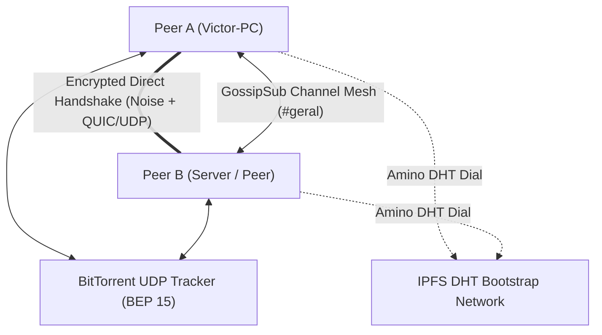

<div align="center">

# ⚡ Anarchord

### The Serverless, Zero-Censorship, 100% Peer-to-Peer Discord Engine

[](https://www.rust-lang.org/)
[](LICENSE)
[](https://libp2p.io/)
[](https://noiseprotocol.org/)
[]()

**Anarchord** is an open-source, serverless communication ecosystem inspired by Discord.  
Built in **Rust** from the ground up, it eliminates centralized servers, tracking, and corporate gatekeeping by establishing a decentralized, encrypted mesh between peer nodes using **IPFS Amino DHT**, **BitTorrent Open Trackers**, and **libp2p**.

</div>

---

## 🌟 Key Features

* 🔐 **Cryptographic Self-Sovereign Identity:** No emails, passwords, or phone numbers. Your identity is a permanent **Ed25519** keypair stored locally.
* 🌐 **Hybrid Auto-Discovery (Zero-Config):**
  * **Primary:** Global IPFS Amino DHT bootstrap nodes.
  * **Fallback:** Public BitTorrent UDP Trackers (BEP 15) querying deterministic hashes in < 500ms.
* 💬 **Mesh Text Channels & Terminal UI (TUI):** Built on `libp2p-gossipsub` with end-to-end cryptographic message signing (`Ed25519`), **MLS** (RFC 9420) encrypted servers, and a reactive, interactive dashboard built with **Ratatui** (featuring dynamic online peers, friends list with presence, audio meters, blinking input cursor, and mouse support).
* 🔒 **1:1 E2EE Direct Messages & Offline Friend Guardians:** Private direct messages encrypted with **X25519** + **HKDF-SHA256** + **ChaCha20-Poly1305** and **Ephemeral Session Keys** (Forward Secrecy). Offline messages are delivered via **Friend Guardians** using a **Sign-then-Seal** store-and-forward mailbox with event-driven delegation, sovereign TTL negotiation, and restart-safe deduplication (`ReceiptAck`).
* 🛡️ **Asymmetric DM Application Firewall:** Configurable per-node defense (`config.json` / `/firewall`) distinguishing **Friends** from **Strangers** (since friendship is asymmetric), with progressive rate/size/offline blocking (`1m → 5m → 30m → 24h`) and a single E2EE courtesy block notice.
* 📁 **Decentralized File Swarm (IPFS CIDv1):** Multi-peer chunked file delivery (`/anarchord/files/1`) with SHA-256 verification, seeder promotion, automatic resume across restarts, and per-chunk encryption inside servers.
* 🎙️ **Real-Time Voice Architecture (Opus 48kHz):** Full-duplex microphone capture, low-latency Opus audio compression, Jitter Buffering, VAD (Voice Activity Detection), and multi-peer audio mixing.
* 📺 **P2P Screen Sharing & Real-Time H.264 Video Stream:** Screen and display capture engine via `xcap` with hardware/native **H.264** compression (`openh264` at 30 FPS with periodic SPS/PPS IDR keyframes, <2ms downscaling, and JPEG fallback), live viewer window via `minifb` displaying real-time FPS, bitrate, and transfer metrics.
* 🐳 **Multi-Stage Docker, 15 Isolated Lab Scenarios & Raw Packet Sniffer:** Distributed test lab (`lab/run.py`): every peer is a container behind its own real NAT router (iptables, cone or symmetric), driven over stdin/stdout by a Python orchestrator with a built-in **Raw Application Packet Sniffer** (`sniffer.rs` / `packets.jsonl`) that dissects wire frames, keys, nonces, ciphertexts, and cryptographic signatures.
* 🚪 **Dynamic OS Ephemeral Ports:** No need to configure or hardcode ports; the OS assigns available ports on boot and announces them automatically.
* 🤝 **Intelligent Connection Deduplication:** Detects simultaneous handshakes and tears down redundant connections without dropping the primary session.
* 🛡️ **NAT Traversal & Firewall Punching:** Built-in **DCUtR** (Direct Connection Upgrade through Relay) and **AutoNAT** protocols.

---

## 🏗️ Architecture Overview

The repository is organized as a modular Cargo Workspace:

```text
anarchord/
├── crates/
│   ├── p2p-core/      # Core headless P2P engine (Identity, DHT, Trackers, GossipSub, MLS, DMs, Mailbox, Sniffer)
│   ├── p2p-cli/       # Interactive Ratatui terminal client and screen viewer
│   └── p2p-agent/     # Headless JSON-over-stdio node for bots and distributed lab testing
├── lab/               # Distributed Docker + real NAT test lab (anarlab) & 15 automated scenarios
├── Cargo.toml         # Workspace definition
└── README.md
```

### Communication & Discovery Flow



---

## 🚀 Quick Start (Running the CLI)

### Prerequisites
* [Rust](https://rustup.rs/) (stable toolchain)
* Git

### 1. Clone the repository
```bash
git clone https://github.com/VictorGerin/anarchord.git
cd anarchord
```

### 2. Run your P2P Node
Simply launch the client. Anarchord will generate your cryptographic key on first boot and automatically join the network:

```bash
cargo run -p p2p-cli -- --nick "YourNickname"
```

> **Note:** Anarchord automatically picks a free dynamic port from your OS and discovers active peers across the globe via BitTorrent open trackers and the IPFS DHT!

---

## 💬 Interactive CLI Commands

While inside the chat console, you can use built-in slash commands:

| Command | Action |
| :--- | :--- |
| `<message>` + `Enter` | Sends a cryptographically signed message to the active channel or active `@Friend` DM space. |
| `/peers` | Displays all currently connected P2P peers, their public Peer IDs, announced/negotiated protocol versions (`v1-v2`), and active capabilities. |
| `/join <channel>` / `/lobby` | Dynamically switches chat rooms (e.g., `/join gaming`) or returns to the Lobby. |
| `/friends` | Lists all friends in `identity.json` with their online/offline presence status. |
| `/friend add <pubkey\|nick> [alias]` | Adds a peer to your local friends list (authorizing them as a mutual DM guardian). |
| `/friend remove <pubkey\|nick>` | Removes a peer from your friends list. |
| `/dm <peer> <msg> [--ttl <duration>]` | Sends a 1:1 E2EE Direct Message (with optional offline guardian TTL override). |
| `/dm open <peer>` | Opens a dedicated `@Peer` E2EE Direct Message conversation space in the TUI. |
| `/config` / `/config set <key> <val>` | Views or updates node configuration (`config.json`: mailbox quotas, TTLs, DM firewall limits). |
| `/firewall` / `/firewall unblock <peer>` | Inspects active DM firewall policies/blocks or manually unblocks a peer. |
| `/server ...` | Creates and manages decentralized MLS-encrypted servers, invites, channels, roles, and bans. |
| `/share <file>` / `/send <peer> <file>` | Shares a file in the current space swarm (`CIDv1`) or sends directly to a peer. |
| `/get <id>` / `/reject <id>` / `/files` | Downloads an offered file, rejects an offer, or lists active/completed transfers. |
| `/voice join <room>` / `/voice leave` | Joins or leaves real-time P2P voice mesh with Opus audio. |
| `/mute` | Toggles microphone mute/unmute state. |
| `/devices` | Lists available audio input (mics) and output (speakers) hardware devices. |
| `/screen list` | Lists all detected physical monitors and displays. |
| `/screen start [monitor_idx]` | Starts real-time screen capture and streaming to the P2P mesh. |
| `/screen stop` | Stops active screen share broadcast. |
| `/screen watch <peer>` | Opens a native lightweight window (`minifb`) to watch a peer's screen in real time. |
| `/quit` | Cleanly shuts down the node and closes network sockets. |

---

## 🗺️ Project Roadmap

O desenvolvimento do Anarchord é gerenciado de forma transparente e orientada a issues no GitHub:

- 🎯 **[Milestones do Projeto](https://github.com/VictorGerin/anarchord/milestones)**: Acompanhe o progresso das versões macro (`v0.2`, `v0.3`, `v0.4`, `v0.5`) com porcentagem de conclusão e entregas.
- 📋 **[Quadro de Tarefas & Issues Abertas](https://github.com/VictorGerin/anarchord/issues)**: Todas as tarefas técnicas, critérios de aceitação e discussões ativas de arquitetura.
- 📖 **[Princípios de Design & Modelo de Ameaças](https://github.com/VictorGerin/anarchord/wiki/Principios-e-Modelo-de-Ameacas)**: Documentação conceitual, limites criptográficos e premissas de segurança.

---

## 🧪 Testing

Anarchord maintains comprehensive automated unit, integration, TUI, and distributed NAT container tests across all modules.

To run the complete test suite:
```bash
cargo test --workspace
python lab/run.py
```

---

## 📄 License

This project is licensed under the **MIT License** - see the [LICENSE](LICENSE) file for details.
