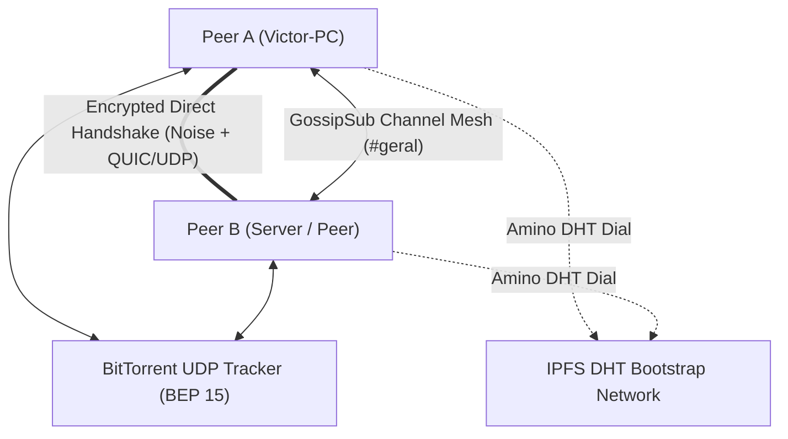

<div align="center">

# ⚡ Anarchord

### The Serverless, Zero-Censorship, 100% Peer-to-Peer Discord Engine

[](https://www.rust-lang.org/)
[](LICENSE)
[](https://libp2p.io/)
[](https://noiseprotocol.org/)
[]()

**Anarchord** is an open-source, serverless communication ecosystem inspired by Discord.  
Built in **Rust** from the ground up, it eliminates centralized servers, tracking, and corporate gatekeeping by establishing a decentralized, encrypted mesh between peer nodes using **IPFS Amino DHT**, **BitTorrent Open Trackers**, and **libp2p**.

</div>

---

## 🌟 Key Features

* 🔐 **Cryptographic Self-Sovereign Identity:** No emails, passwords, or phone numbers. Your identity is a permanent **Ed25519** keypair stored locally.
* 🌐 **Hybrid Auto-Discovery (Zero-Config):**
  * **Primary:** Global IPFS Amino DHT bootstrap nodes.
  * **Fallback:** Public BitTorrent UDP Trackers (BEP 15) querying deterministic hashes in < 500ms.
* 💬 **Mesh Text Channels & Terminal UI (TUI):** Built on `libp2p-gossipsub` with end-to-end cryptographic message signing (`Ed25519`) and a reactive, interactive dashboard built with **Ratatui** (featuring dynamic online peers, audio meters, blinking input cursor, and mouse support).
* 📁 **Direct P2P File Transfer:** Point-to-point chunked file delivery with SHA-256 verification, handshakes (`Offer` / `Accept`), and live progress gauges.
* 🎙️ **Real-Time Voice Architecture (Opus 48kHz):** Full-duplex microphone capture, low-latency Opus audio compression, Jitter Buffering, VAD (Voice Activity Detection), and multi-peer audio mixing.
* 📺 **P2P Screen Sharing & Real-Time H.264 Video Stream:** Screen and display capture engine via `xcap` with hardware/native **H.264** compression (`openh264` at 30 FPS with periodic SPS/PPS IDR keyframes, <2ms downscaling, and JPEG fallback), live viewer window via `minifb` displaying real-time FPS, bitrate, and transfer metrics.
* 🐳 **Multi-Stage Docker & 100% Isolated End-to-End Test Suite:** Fully reproducible local testing harness (`docker-compose.test.yml` + `tests/run_docker_tests.py`) simulating multi-peer topologies (Alice, Bob, Carol + Local-Bootstrap) across isolated NAT subnets with zero leaks to the global DHT.
* 🚪 **Dynamic OS Ephemeral Ports:** No need to configure or hardcode ports; the OS assigns available ports on boot and announces them automatically.
* 🤝 **Intelligent Connection Deduplication:** Detects simultaneous handshakes and tears down redundant connections without dropping the primary session.
* 🛡️ **NAT Traversal & Firewall Punching:** Built-in **DCUtR** (Direct Connection Upgrade through Relay) and **AutoNAT** protocols.

---

## 🏗️ Architecture Overview

The repository is organized as a modular Cargo Workspace:

```text
anarchord/
├── crates/
│   ├── p2p-core/      # Core headless P2P engine (Identity, DHT, Trackers, GossipSub, Audio Buffer)
│   └── p2p-cli/       # Interactive terminal client and background daemon
├── Cargo.toml         # Workspace definition
└── README.md
```

### Communication & Discovery Flow



---

## 🚀 Quick Start (Running the CLI)

### Prerequisites
* [Rust](https://rustup.rs/) (stable toolchain)
* Git

### 1. Clone the repository
```bash
git clone https://github.com/VictorGerin/anarchord.git
cd anarchord
```

### 2. Run your P2P Node
Simply launch the client. Anarchord will generate your cryptographic key on first boot and automatically join the network:

```bash
cargo run -p p2p-cli -- --nick "YourNickname"
```

> **Note:** Anarchord automatically picks a free dynamic port from your OS and discovers active peers across the globe via BitTorrent open trackers and the IPFS DHT!

---

## 💬 Interactive CLI Commands

While inside the chat console, you can use built-in slash commands:

| Command | Action |
| :--- | :--- |
| `<message>` + `Enter` | Sends a cryptographically signed message to the active channel. |
| `/peers` | Displays all currently connected P2P peers and their public Peer IDs. |
| `/join <channel>` | Dynamically switches chat rooms (e.g., `/join gaming`) without restarting. |
| `/send <peer> <file>` | Initiates direct P2P file transfer to a target peer with SHA-256 integrity verification. |
| `/accept <hash>` / `/reject <hash>` | Accepts or denies an incoming P2P file transfer request. |
| `/voice join <room>` / `/voice leave` | Joins or leaves real-time P2P voice mesh with Opus audio. |
| `/mute` | Toggles microphone mute/unmute state. |
| `/devices` | Lists available audio input (mics) and output (speakers) hardware devices. |
| `/screen list` | Lists all detected physical monitors and displays. |
| `/screen start [monitor_idx]` | Starts real-time screen capture and streaming to the P2P mesh. |
| `/screen stop` | Stops active screen share broadcast. |
| `/screen watch <peer>` | Opens a native lightweight window (`minifb`) to watch a peer's screen in real time. |
| `/quit` | Cleanly shuts down the node and closes network sockets. |

---

## 🗺️ Project Roadmap

### Phase 1: Core Network & Discovery ✅ (Completed)
- [x] Cryptographic Identity generation & persistence (`Ed25519Dalek`).
- [x] Transport layers: **QUIC** (UDP) and **TCP** with **Yamux** and **Noise Protocol**.
- [x] Dual-engine Auto-Discovery:
  - [x] IPFS Amino DHT Bootstrap.
  - [x] BitTorrent UDP Open Trackers Client (BEP 15) with compact peer parsing.
- [x] Connection deduplication via `close_connection`.
- [x] OS dynamic port allocation (`port = 0`).
- [x] Periodic 10s Tracker re-announcement and continuous peer re-discovery.
- [x] Multi-subnet automated End-to-End Docker test harness (`tests/run_docker_tests.py`).

### Phase 2: Decentralized Text Mesh, TUI & File Transfer ✅ (Completed)
- [x] GossipSub channel routing (e.g. `p2p-anarchord/channel/<channel>`).
- [x] Cryptographic verification: All messages signed by author's private key.
- [x] Interactive Terminal User Interface (**Ratatui**) with dynamic online peers, blinking input cursor, and mouse click interactions.
- [x] Direct P2P File Transfer subsystem:
  - [x] Chunked delivery (64KB chunks), GossipSub max transmit size expansion (1MB).
  - [x] Transmission pacing, handshake negotiations, and SHA-256 verification.
- [ ] Offline history synchronization via peer-to-peer Request-Response / CRDT.

### Phase 3: Real-Time P2P Voice (Opus) ✅ (Completed)
- [x] `VoicePacket` 20ms protocol specification with VAD energy calculation.
- [x] `JitterBuffer` with sequence sorting and duplicate/late packet dropping.
- [x] Native audio capture & playback via `cpal` (WASAPI, ALSA).
- [x] Opus audio compression & decompression (`opus1` VoIP mode @ 48kHz).
- [x] Multi-peer audio mixing and active speaker indicators (`[FALANDO]`).
- [x] Headless synthetic audio generator (`--synth-audio`) for automated testing.

### Phase 4: Screen Sharing & Native Video Streaming ✅ (Completed)
- [x] Cross-platform screen and window capture engine via `xcap`.
- [x] Real-time H.264 video codec integration (`openh264` 30 FPS) with periodic SPS/PPS intra-frames and high-speed downscaling.
- [x] Pure Rust JPEG fallback encoder (`jpeg-encoder`).
- [x] Real-time P2P video frame distribution (`ScreenPacket`) across Gossipsub mesh.
- [x] Ultra-lightweight native graphical viewer window via `minifb` (`/screen watch <peer>`) with real-time FPS, bitrate, and data metrics.
- [x] Automated loop video transmission (`--synth-video`) for server/bot testing.
- [x] Multi-peer isolated Docker test suite (`tests/run_docker_tests.py`) verifying 3+ concurrent nodes.

### Phase 5: Modern Desktop GUI & Mobile App ⏳ (Upcoming)
- [ ] Cross-platform desktop application with **Tauri** (Rust backend + React / Tailwind CSS).
- [ ] Server creation & cryptographically signed community metadata.
- [ ] Offline chat persistence (SQLite / embedded CRDT store).

---

## 🧪 Testing

Anarchord maintains comprehensive automated unit and integration tests across all modules.

To run the complete test suite:
```bash
cargo test --workspace
```

---

## 📄 License

This project is licensed under the **MIT License** - see the [LICENSE](LICENSE) file for details.
